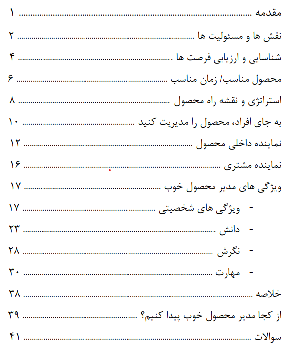

| Book Specification | Details |
| :--- | :--- |
| **Author** | Marty Cagan (SVPG) |
| **Category** | Leadership |
| **Page Count** | 36 pages |
| **Format & Quality** | PDF • Standard Digital Edition |
| **File Size** | 1.1 MB |
| **Target Audience** | Specialized • Product Managers & Innovators |

---

| Book Specification | Details |
| :--- | :--- |
| **Author** | Marty Cagan (SVPG) |
| **Category** | Leadership |
| **Page Count** | 36 pages |
| **Format & Quality** | PDF • Standard Digital Edition |
| **File Size** | 1.1 MB |
| **Target Audience** | Specialized • Product Managers & Innovators |

---

### 📖 About the Book & Core Premise

Every member of the product team matters. For a company to succeed, it has to design, build, test, and sell the product correctly and precisely. The product manager is the role that has the most effect on building the right product—and is often the most disposable as well.

In this piece we talk about the responsibilities of a good product manager, then turn to the traits themselves, how to acquire them, and how to develop them.

[Download the original edition](https://svpg.com/assets/Files/productmanager.pdf)

---

### 💡 Why This Book Matters in 2026

In an era of accelerated delivery and AI-driven automation, mastering the core principles of leadership
provides a durable competitive advantage for modern product practitioners and organizations.

---

### 🎯 Who Should Read This Book?

* **Product Managers & Leaders:** To enhance strategic decision-making and cross-functional alignment.
* **UX Designers & Researchers:** To better integrate customer insights into product architecture.
* **Founders & Technology Executives:** To build resilient, high-velocity product teams.

---

### 📥 Download Book File


