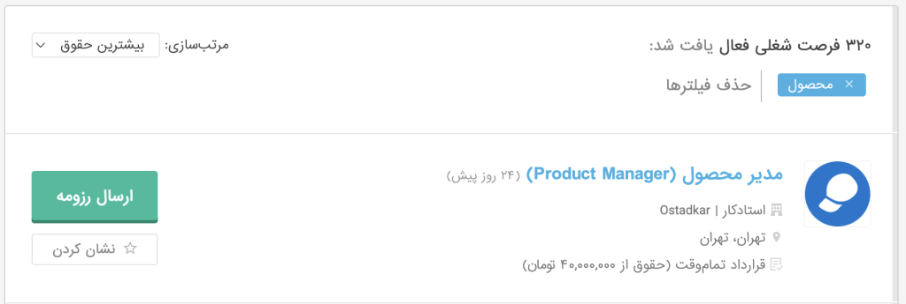
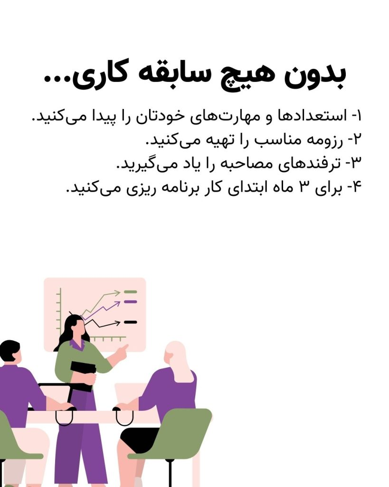

| Book Specification | Details |
| :--- | :--- |
| **Author** | TheMiniCEO Editorial Team |
| **Category** | Leadership |
| **Page Count** | 84 pages |
| **Format & Quality** | PDF • Standard Digital Edition |
| **File Size** | 3.0 MB |
| **Target Audience** | Specialized • Product Managers & Innovators |

---

| Book Specification | Details |
| :--- | :--- |
| **Author** | TheMiniCEO Editorial Team |
| **Category** | Leadership |
| **Page Count** | 84 pages |
| **Format & Quality** | PDF • Standard Digital Edition |
| **File Size** | 3.0 MB |
| **Target Audience** | Specialized • Product Managers & Innovators |

---

### 📖 About the Book & Core Premise

Did you know there are 321 product-related job openings on Jobinja?

People usually say that becoming a product manager requires a lot of work experience, familiarity with many concepts, and taking many courses.

But that is not the only path.

In this workshop you prepare, as quickly as possible, to enter the job market so you can wrestle with product challenges in practice.

Topics we cover in this intensive two-hour workshop:

1. Finding your personal talents and skills

3. Preparing a suitable résumé

5. Reviewing product-interview questions and interview tactics

7. Planning for the first three months on the job

* * *

Register through the section below. After you register, the workshop link will be sent to you. If you want the TheMiniCEO team to support you until you are hired, register for the special course.

---

### 💡 Why This Book Matters in 2026

In an era of accelerated delivery and AI-driven automation, mastering the core principles of leadership
provides a durable competitive advantage for modern product practitioners and organizations.

---

### 🎯 Who Should Read This Book?

* **Product Managers & Leaders:** To enhance strategic decision-making and cross-functional alignment.
* **UX Designers & Researchers:** To better integrate customer insights into product architecture.
* **Founders & Technology Executives:** To build resilient, high-velocity product teams.

---

### 📥 Download Book File


