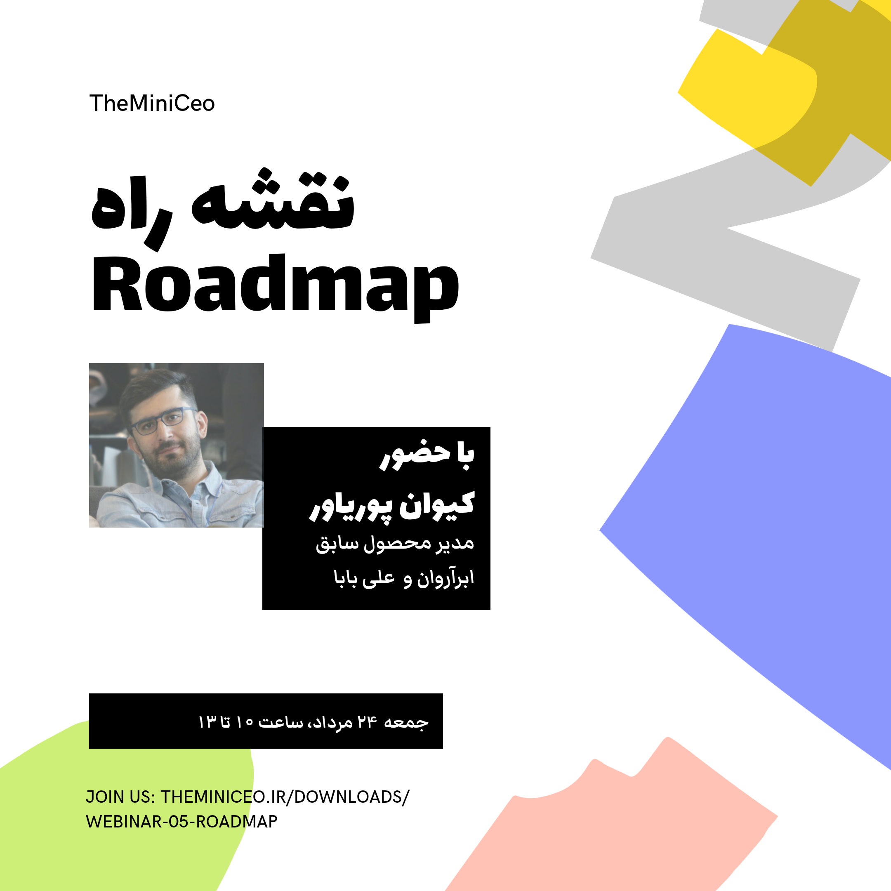

| Book Specification | Details |
| :--- | :--- |
| **Author** | TheMiniCEO Webinar Series |
| **Category** | Product Strategy |
| **Page Count** | 62 pages |
| **Format & Quality** | PDF • Standard Digital Edition |
| **File Size** | 4.0 MB |
| **Target Audience** | Specialized • Product Managers & Innovators |

---

| Book Specification | Details |
| :--- | :--- |
| **Author** | TheMiniCEO Webinar Series |
| **Category** | Product Strategy |
| **Page Count** | 62 pages |
| **Format & Quality** | PDF • Standard Digital Edition |
| **File Size** | 4.0 MB |
| **Target Audience** | Specialized • Product Managers & Innovators |

---

### 📖 About the Book & Core Premise

TheMiniCEO webinars, with an experience-sharing approach, are a place to learn and teach specific product-management and business concepts.

Buying this ticket also gives you access to the next event.

After payment, your email is stored and the webinar link is emailed to you one day before the event.

---

### 💡 Why This Book Matters in 2026

In an era of accelerated delivery and AI-driven automation, mastering the core principles of product strategy
provides a durable competitive advantage for modern product practitioners and organizations.

---

### 🎯 Who Should Read This Book?

* **Product Managers & Leaders:** To enhance strategic decision-making and cross-functional alignment.
* **UX Designers & Researchers:** To better integrate customer insights into product architecture.
* **Founders & Technology Executives:** To build resilient, high-velocity product teams.

---

### 📥 Download Book File


